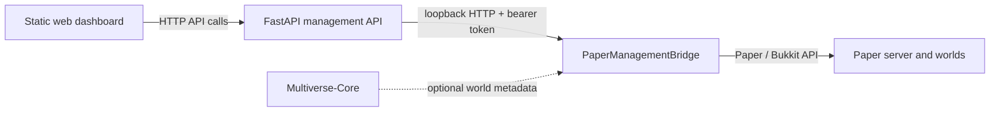

# Minecraft Server Platform

A self-hosted Minecraft administration project built around Paper, a small Java management bridge, and a static web dashboard. It is an ongoing engineering portfolio project; this repository documents and develops the checked-in components rather than claiming a complete turnkey platform.

> **Current implementation note:** The FastAPI source is now included under `management-api/` as a sanitized copy of the deployed implementation. A fresh clone still needs locally supplied access-proxy settings, secret files, Minecraft services, and deployment configuration before it can run end to end.

## What is in this repository

| Component | Status in this checkout |
|---|---|
| PaperManagementBridge | Java 21 Maven plugin. Provides local HTTP health, world/Multiverse listing, gamerule, and confirmed world lifecycle operations. |
| Web dashboard | Static HTML, CSS, and JavaScript. Includes server/player controls, gamerule editing, world overview, creation, ZIP import, load/unload, and reversible archive/restore flows. Requires the management API. |
| FastAPI management API | Tracked under `management-api/`; provides authenticated server/player/settings/world routes. Uses external secret files and environment-specific settings. |
| Automated tests | 23 Python API tests, 22 Node dashboard tests, and 8 Java bridge validation tests; Maven verifies the bridge build. Two Java symlink tests skip where Windows symlink creation is unavailable. Browser login, live world mutations, and clean-room deployment are not covered. |
| Deployment documentation | Historical notes are available under `docs/`; verify environment-specific steps before use. |

## Architecture



The browser should communicate with the management API, not directly with the Paper bridge. The bridge binds to loopback and must not be exposed to the public internet. See the [management API setup guide](management-api/README.md) and [API/bridge contract](docs/management-api.md).

## Screenshots

**Placeholder:** No privacy-reviewed dashboard screenshots are included yet. Add screenshots only after replacing real player names, private addresses, account identities, and infrastructure details with safe sample data.

## Feature status

### Present in the checked-in code

- Bridge health and world information endpoints.
- Multiverse world metadata when Multiverse-Core is available.
- Per-world gamerule reads and writes with type validation.
- Dashboard world search, loaded/unloaded filtering, per-world online player counts, and a shortcut to the existing gamerule editor.
- Confirmed world load/unload and world creation with environment, type, game mode, difficulty, and structures options.
- Validated ZIP world import and reversible archive/restore; permanent deletion is deliberately unavailable.
- Dashboard player, whitelist, operator, and moderation interfaces that call management API routes.
- A focused client-side test for moderation payloads.
- The recovered FastAPI management API and its pinned dependencies; integration setup still depends on private infrastructure and secret files.

### Not yet reproducible from this repository

- A complete fresh-install path for the integrated dashboard/API/bridge system.
- Permanent world deletion with an off-host verified recovery point.
- End-to-end tests against a real Paper server.

Planned features are tracked in the private local roadmap and should not be represented as implemented until code and verification are added.

## Repository map

```text
.
├── docs/
│   ├── hardware.md
│   ├── backup-and-restore.md
│   ├── getting-started.md
│   ├── management-api.md
│   ├── minecraft-server.md
│   ├── PROJECT_HANDOVER.md
│   ├── proxmox.md
│   ├── troubleshooting.md
│   └── world-management.md
├── .github/
│   ├── ISSUE_TEMPLATE/
│   ├── PULL_REQUEST_TEMPLATE.md
│   └── workflows/ci.yml
├── paper-management-bridge/
│   ├── pom.xml
│   └── src/main/
├── management-api/
│   ├── app/
│   ├── requirements.txt
│   └── README.md
└── web-dashboard/
    ├── index.html
    ├── styles.css
    ├── app.js
    └── tests/
```

`PROJECT_ROADMAP.md` and `docs/private-infrastructure.md` are local-only files and are deliberately ignored by Git. They are not published with this repository.

## Requirements

For local development:

- Java Development Kit 21.
- Apache Maven.
- Node.js with the built-in test runner (for the dashboard test).
- Python 3.11 or newer (for the FastAPI management API).
- A Paper server compatible with the version in `paper-management-bridge/pom.xml` to load the built plugin.
- Multiverse-Core is optional at runtime; it supplies additional world metadata.

The historical deployment uses Proxmox VE and an LXC container, but the current repository does not provide a complete infrastructure provisioning script. Use the docs as historical reference and substitute your own hostnames, addresses, users, and paths.

## Build the Paper bridge

Run on a development machine from the repository root:

```powershell
cd paper-management-bridge
mvn --batch-mode --no-transfer-progress clean verify
```

Expected result: Maven builds the plugin JAR under `paper-management-bridge/target/` and passes the bridge validation tests. The `provided` Paper and Multiverse dependencies are supplied by the server and are not bundled as server replacements.

The bridge expects its bearer token in a host-side secret file configured by the plugin source. Never place that token in the dashboard, source control, screenshots, or public documentation. Install/deployment steps should be followed only after reviewing [the bridge security notes](docs/management-api.md#security).

## Run the dashboard

The dashboard is static. Open `web-dashboard/index.html` in a browser for a UI shell, but live data and administrative actions require a compatible management API and same-origin/reverse-proxy setup. The API base can be configured before `app.js` loads using `window.MINECRAFT_API_BASE`; do not put bridge credentials in browser code.

The API's setup and required environment variables are documented in [management-api/README.md](management-api/README.md). A fresh clone cannot connect to Minecraft until the required services and private configuration files are provided.

## Tests and checks

GitHub Actions compiles the FastAPI source, runs its unit tests and the dashboard's client-side tests, and packages the Paper bridge on pushes and pull requests targeting `main`. It does not test a live Minecraft server.

Run the API checks from `management-api/` with Python 3.12 or newer:

```powershell
python -m compileall -q app
python -m unittest discover -s tests -v
```

Run the mocked dashboard workflow tests from `web-dashboard/` on a development machine with Node.js:

```powershell
node --test tests/*.test.cjs
```

These tests use mocked `fetch` calls and do not contact Minecraft. The API tests cover middleware identity/origin checks, route validation, and ZIP safety but do not contact Paper. The deployed service received read-only health/world-list smoke checks on 10 November 2026; mutating world actions have not been tested against live worlds.

## Security and privacy

- Keep the Paper bridge bound to loopback and behind the management API.
- Do not expose Proxmox management, the bridge port, or unauthenticated API routes publicly.
- Never commit passwords, private keys, bearer tokens, tunnel credentials, private IP/MAC/SSH inventory, or personal/player identifiers.
- Use placeholders in public examples and check Git history before publishing changes.
- World archive imports enforce path, link, size, entry-count, and free-space checks. Permanent deletion remains unavailable until off-host recovery can be verified.

## Documentation

- [Getting started and integration setup](docs/getting-started.md)
- [Management API and Paper bridge](docs/management-api.md)
- [FastAPI setup and configuration](management-api/README.md)
- [World management](docs/world-management.md)
- [Changelog](CHANGELOG.md)
- [Minecraft server notes](docs/minecraft-server.md)
- [Proxmox notes](docs/proxmox.md)
- [Hardware notes](docs/hardware.md)
- [Backup and isolated restore](docs/backup-and-restore.md)
- [Troubleshooting](docs/troubleshooting.md)
- [Sanitized project handover](docs/PROJECT_HANDOVER.md)

These files include deployment history and are being reconciled with the checked-in implementation. Treat version numbers and historical verification records as dated, environment-specific information.

## Contributing

This project is being developed incrementally. Before contributing, check the open issues and discuss larger changes with the maintainer. Keep pull requests focused, document the environment and commands used, and do not include private infrastructure information.

## License and reuse

No license file is currently provided. The repository is publicly viewable, but no permission to reuse, modify, or redistribute the code is granted by this README. A formal rights policy has not yet been selected; do not assume this project is open source under a standard license.

## Project status

The project is actively evolving. The next priorities are isolated Paper/Multiverse integration tests for world lifecycle actions, clean-room verification of the getting-started guide, and coordinated privacy review of older Git history before publishing the current local changes.
