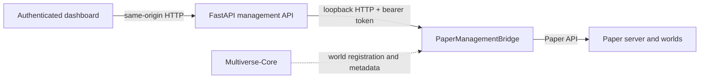

# Management API and Paper bridge

This page documents the checked-in FastAPI source, Java bridge, and current verification boundary. The live service configuration, access identity list, and bearer/Management Protocol secrets remain outside Git. See the [API setup guide](../management-api/README.md), [integrated getting-started guide](getting-started.md), and [world-management guide](world-management.md).

For service/API failures, see the [troubleshooting guide](troubleshooting.md).

## Architecture



The browser calls FastAPI; it never receives the bridge token. The bridge listens only on loopback at port `25586`. The API reads the bridge token and Paper Management Protocol secret from external files.

## Bridge routes

The bridge requires `Authorization: Bearer <token>` on every request, including health and read-only routes. It binds to `127.0.0.1`.

| Method | Path | Behavior and safeguards |
|---|---|---|
| GET | `/health` | Authenticated bridge health. |
| GET | `/worlds` | Loaded Paper worlds with environment and online player counts. |
| GET | `/multiverse/worlds` | Registered Multiverse worlds, aliases, environment, loaded state, and archive state. |
| GET | `/worlds/gamerules?world=<name>` | Reads supported typed gamerules for a loaded world. |
| PUT | `/worlds/gamerules` | Changes a supported boolean or integer gamerule on the Paper thread. |
| POST | `/worlds/load` | Loads an existing registered world. Requires exact name confirmation. |
| POST | `/worlds/unload` | Saves and unloads a non-primary world with no players. |
| POST | `/worlds/create` | Creates a world using validated environment, type, mode, difficulty, and structure settings. |
| POST | `/worlds/import` | Registers a validated world directory with Multiverse; the API first extracts ZIP uploads safely. |
| POST | `/worlds/archive` | Saves/unloads a non-primary, empty world and moves its directory into `.management-world-trash`. Multiverse autoload is disabled and saved. |
| POST | `/worlds/restore` | Returns an archived directory and restores its prior Multiverse autoload setting. The world stays unloaded. |

Lifecycle names use one path-safe segment (ASCII letters, digits, dot, underscore, hyphen; up to 32 characters). State-changing calls require exact typed-name confirmation. The bridge refuses the primary world and worlds with players for unload/archive. There is no arbitrary shell execution or client-provided filesystem path.

## FastAPI routes

The API checks `Tailscale-User-Login` against an external allowlist on every request. For `POST`, `PUT`, `PATCH`, and `DELETE`, it also requires the `Origin` header to exactly match `MINECRAFT_DASHBOARD_ORIGIN`. Keep the API behind the trusted access proxy that supplies the identity header; direct clients must not be able to spoof that header.

Relevant world routes:

| Method | API path | Notes |
|---|---|---|
| GET | `/bridge/health`, `/worlds`, `/worlds/multiverse` | Read-only health and world listings. |
| GET/PUT | `/worlds/gamerules` | Reads/updates typed rules for a loaded world. |
| POST | `/worlds/load`, `/worlds/unload`, `/worlds/create` | Validates names/settings and forwards narrow requests to the bridge. |
| POST | `/worlds/import` | Raw `application/zip` body, up to 256 MiB. Headers carry world name, exact confirmation, and environment. |
| POST | `/worlds/register` | Registers an existing world folder after an import/registration failure; requires a regular `level.dat` and rejects symlinks. |
| POST | `/worlds/archive`, `/worlds/restore` | Exact confirmation; reversible same-filesystem move, never permanent deletion. |

ZIP import rejects absolute/traversal paths, symlinks and special files, encrypted entries, duplicate paths, excessive compression ratios, more than 100,000 entries, expansion above 8 GiB, invalid world layout, and insufficient free space. It never intentionally overwrites an existing world. If extraction succeeds but Multiverse registration fails, the files are retained and `/worlds/register` can retry registration.

## Security limits and operational behavior

- Keep bridge port `25586` loopback-only; do not publish the token or expose the bridge.
- Use an access proxy that authenticates users, overwrites identity headers, and blocks direct access to the API.
- Preserve the dashboard origin and allowlist in private service configuration. Example settings fail closed for writes.
- Archive/restore is not a backup: it is on the same filesystem and does not protect against CT, disk, or host loss.
- Permanent world deletion is not implemented. Do not add it until off-host recovery and restore are verified.
- Treat create/import as resource-intensive. The server host has limited memory; check free disk and memory before use.

## Build and test

From the repository root, build the Paper plugin on a development machine with JDK 21 and Maven:

```powershell
cd paper-management-bridge
mvn --batch-mode --no-transfer-progress clean verify
```

Run API checks from `management-api/` with Python 3.12 or newer:

```powershell
python -m compileall -q app
python -m unittest discover -s tests -v
```

Run dashboard tests from `web-dashboard/` with Node.js 22:

```powershell
node --test tests/*.test.cjs
```

Current local verification: 26 API tests (one Windows symlink limitation skip), 22 dashboard tests, and 8 Java bridge validation tests pass; Maven `clean verify` succeeds. Two Java symlink tests may skip on Windows. ASGI-level tests exercise authenticated same-origin create/load/unload/archive/restore requests and reject a cross-origin request while mocking the bridge; they do not create a Paper world. The earlier 17-test API suite also passed on CT100's Linux runtime, including its symlink check. A live request to load a confirmed, uppercase, unregistered probe name was rejected with HTTP 404 before any world action. This does not prove successful world mutations on Paper. On 10 November 2026, API health, bridge health, world list, Multiverse list, and dashboard requests returned HTTP 200 after deployment.

## Deployment status and limitations

The sanitized API source, dashboard, and rebuilt bridge were deployed to CT100 on 10 November 2026. A recent SSD-stored CT backup and rollback copies were verified before deployment. Both services are active. The private dashboard origin is held outside Git in a restricted file and systemd drop-in. No live world mutation was performed. The isolated Paper/Multiverse lifecycle checks now pass on GitHub Actions, including import/register, malformed restore metadata rejection, and rollback after a forced Multiverse save failure. A clean-clone installation remains outstanding.
