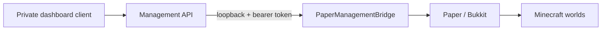

# Minecraft server deployment notes

This is a dated record of the owner’s Paper deployment. It is not a complete infrastructure provisioning guide. The sanitized FastAPI source is tracked under `management-api/`, but deployment configuration and private files are not. Replace all placeholders with values from your own environment.

## Recorded deployment snapshot

Last live checks recorded on 10 November 2026:

| Item | Recorded value |
|---|---|
| Server software | Paper for Minecraft 1.21.x; confirm exact version before upgrades |
| Runtime | Java 21 |
| Container | Proxmox LXC, CT ID 100 |
| Container OS | Debian 13 (Trixie) |
| Container allocation | 2 CPU cores, 2 GiB RAM, 40 GiB root disk |
| Minecraft service | `minecraft.service` |
| Server directory | `/opt/minecraft` |
| Java heap (historical) | 1 GiB minimum and maximum |
| Minecraft ports (historical) | Java TCP 25565; Bedrock/Geyser UDP 19132 |

The version and plugin details in older notes are historical and may be out of date. Check compatibility and create a verified backup before updates.

## Installed features (historically reported)

The live server was previously reported to use CoreProtect, EssentialsX, Geyser, Floodgate, ViaVersion, Multiverse-Core, and the custom PaperManagementBridge. Prior notes record successful Java/Bedrock crossplay, whitelist enforcement, Multiverse world management, and per-world gamerule operations. These are historical verification records, not a fresh live check of every plugin or feature.

The checked-in dashboard, FastAPI backend, and bridge support world listing, gamerule management, confirmed load/unload/create, validated ZIP import/registration, and reversible archive/restore. Permanent deletion is intentionally unavailable. The 10 November deployment received read-only health/world-list smoke checks; successful world lifecycle changes have not been tested against live worlds.

## Management path

The browser should call the authenticated management API. Keep the Paper bridge bound to loopback; do not expose its port or token to browsers or the public internet. The sanitized API source is tracked, but a fresh clone still needs private access configuration, secret files, and running Paper/bridge services to reproduce the complete management path.

## Historical network and access

The actual server addresses, Tailscale identities, tunnel endpoints, player names, and private network details are intentionally omitted. For a personal deployment, use placeholders such as:

- `YOUR_MINECRAFT_HOST`
- `YOUR_TAILSCALE_HOSTNAME`
- `YOUR_BEDROCK_TUNNEL_HOST:PORT`

Historical notes record private remote access and a Bedrock tunnel, but verify the current provider, endpoints, and security settings before use. Do not expose Proxmox management or the management bridge publicly. Review `online-mode` and Floodgate/proxy configuration before enabling any public connectivity.

## Backups

The Proxmox host stores CT100 backups on a separate 256 GB EVM SATA SSD registered as backup-only storage. A manual snapshot backup was created on 10 November 2026 and passed a Zstandard archive integrity check. The existing scheduled CT100 backup job was redirected to the SSD; it uses snapshot mode, Zstandard compression, and the configured retention policy.

The SSD is in the same physical computer. It can help if the Toshiba system HDD fails, but not if the whole PC is lost. A test restore to a temporary stopped, disconnected container verified key files and world directories; Minecraft was not started in that clone. Keep an additional copy off-machine and periodically test a full restore.

For current storage and backup details, see [Proxmox notes](proxmox.md). Do not rely on old dated archive names as the current backup inventory.

## Operations guidance

- Verify the exact Paper/Java/plugin versions before maintenance.
- Check host memory and swap before increasing the 2 GiB container allocation or 1 GiB heap; the host has historically had only 4 GiB RAM.
- Stop and back up before changes that could affect world data.
- Keep world operations limited to typed, authenticated API requests. Import applies archive path/link/size/entry/free-space checks; archive is a reversible same-filesystem move, not a backup. Permanent deletion remains unavailable.
- Do not paste service tokens or private infrastructure identifiers into public documentation.

## Related repository docs

- [CT backup and isolated restore guide](backup-and-restore.md)
- [Management API and bridge](management-api.md)
- [Proxmox and storage](proxmox.md)
- [Hardware constraints](hardware.md)
